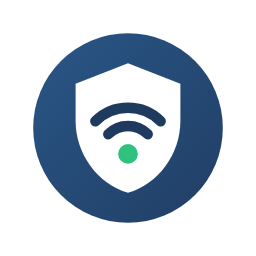

<p align="center">
  
</p>

<h1 align="center">VSA – VPN Switching Application</h1>

<p align="center">
  Android-App, die dein VPN <b>automatisch einschaltet, sobald du dein Heim-WLAN verlässt</b>,<br>
  und <b>wieder ausschaltet, wenn du nach Hause kommst</b>.
</p>

<p align="center">
  <a href="../../releases/latest"><b>⬇ Neueste Version herunterladen</b></a>
</p>

---

## Inhalt

- [Funktionen](#funktionen)
- [Unterstützte VPN-Apps](#unterstützte-vpn-apps)
- [Installation](#installation)
- [Einrichtung](#einrichtung)
- [So funktioniert die Automatik](#so-funktioniert-die-automatik)
- [Berechtigungen & Datenschutz](#berechtigungen--datenschutz)
- [Fehlerbehebung](#fehlerbehebung)
- [Entwicklung](#entwicklung)

## Funktionen

- 🏠 **Heim-WLAN festlegen**: per Knopfdruck das aktuelle WLAN übernehmen oder den Namen eintippen. Mehrere Heim-WLANs sind möglich, z. B. 2,4 GHz und 5 GHz oder Repeater mit eigenem Namen.
- 🔒 **Automatisch schalten**: zuhause VPN aus, unterwegs VPN an.
- ⏱️ **Verzögerung gegen Funklöcher**: nach dem Verlassen wird erst nach einer einstellbaren Zeit verbunden (0–120 s, Standard 20 s). Beim Heimkommen wird sofort getrennt.
- 🔌 **Mehrere VPN-Dienste**: Tailscale, WireGuard oder jede App, die sich per Broadcast steuern lässt.
- 🔁 **Läuft im Hintergrund** und startet nach einem Neustart des Handys von selbst.
- ✋ **Respektiert Handbedienung**: geschaltet wird nur beim Kommen und Gehen. Schaltest du das VPN zwischendurch selbst um, bleibt es so.
- 🧭 **Einrichtungsassistent**: zeigt an, was noch fehlt, und führt mit „Jetzt beheben“ zur richtigen Einstellung.

## Unterstützte VPN-Apps

| VPN-App | Wie VSA sie steuert | Was du tun musst |
|---|---|---|
| **[Tailscale](https://play.google.com/store/apps/details?id=com.tailscale.ipn)** | Broadcast `com.tailscale.ipn.CONNECT_VPN` / `DISCONNECT_VPN` | Einmal einloggen und einmal verbinden |
| **[WireGuard](https://play.google.com/store/apps/details?id=com.wireguard.android)** (offizielle App) | Broadcast `SET_TUNNEL_UP` / `SET_TUNNEL_DOWN` mit Tunnelname | In WireGuard *Einstellungen → „Fernsteuerung durch Apps erlauben“* einschalten, in VSA den Tunnelnamen eintragen und die Berechtigung erlauben |
| **Andere App** | Frei konfigurierbarer Broadcast (Paket, Aktionen, Extras) | Die Broadcast-Schnittstelle der App eintragen (steht in deren Doku) |

> **Warum nicht ProtonVPN, NordVPN, Mullvad & Co.?**
> Android erlaubt Apps nicht, das VPN einer *anderen* App direkt ein- oder auszuschalten. Das geht nur, wenn die VPN-App selbst eine Schnittstelle dafür anbietet, wie Tailscale und WireGuard. Bietet eine App so eine Schnittstelle an, kannst du sie über **„Andere App“** anbinden.

<details>
<summary><b>Beispiel „Andere App“</b>: Tailscale von Hand konfiguriert</summary>

So sähe Tailscale aus, wenn es nicht schon eingebaut wäre:

| Feld | Wert |
|---|---|
| Paketname | `com.tailscale.ipn` |
| Empfänger-Klasse | `com.tailscale.ipn.IPNReceiver` |
| Aktion zum Verbinden | `com.tailscale.ipn.CONNECT_VPN` |
| Aktion zum Trennen | `com.tailscale.ipn.DISCONNECT_VPN` |
| Extras | *(leer)* |

Extras schreibst du als `schlüssel=wert`, eine Zeile pro Extra. Sie werden als Text übergeben. Zeilen, die mit `#` beginnen, werden ignoriert.
</details>

## Installation

1. Unter [**Releases**](../../releases/latest) die Datei `VSA-x.y.z.apk` aufs Handy laden.
2. Öffnen und die Installation aus dieser Quelle erlauben, wenn Android danach fragt.
3. Updates installierst du genauso, einfach über die alte Version drüber. Deine Einstellungen bleiben erhalten.

Voraussetzung: **Android 8.0 oder neuer**.

## Einrichtung

1. **VPN-App vorbereiten**
   - *Tailscale:* öffnen, einloggen, einmal verbinden und die VPN-Anfrage von Android bestätigen.
   - *WireGuard:* Tunnel anlegen, einmal verbinden, dann unter *Einstellungen* „Fernsteuerung durch Apps erlauben“ einschalten.
2. **VSA öffnen** und unter **VPN-Dienst** deine App auswählen. Bei WireGuard oder „Andere App“ die Felder ausfüllen und **Speichern**.
3. Im Heim-WLAN auf **„Aktuelles WLAN hinzufügen“** tippen.
4. **„Automatik aktiv“** einschalten und die Punkte im Kasten **Einrichtung** abarbeiten:
   - Standortzugriff auf **„Immer erlauben“** stellen (siehe [Datenschutz](#berechtigungen--datenschutz)).
   - Standort (GPS) eingeschaltet lassen.
   - Benachrichtigungen erlauben.
   - Empfohlen: Akku-Optimierung für VSA abschalten.
5. Mit **„VPN manuell schalten“** kannst du prüfen, ob VSA deine VPN-App erreicht.

Fertig. In der Benachrichtigung siehst du jederzeit, was VSA gerade tut, z. B. *„Zuhause („FRITZ!Box 7590“) – Tailscale aus“*.

## So funktioniert die Automatik

```
          Heim-WLAN verbunden                    kein / fremdes WLAN
  ┌────────────────────────────────┐   ┌──────────────────────────────────────┐
  │  VPN sofort trennen            │   │  Verzögerung abwarten (Standard 20 s) │
  │  (laufenden Countdown abbrechen)│   │  → VPN verbinden                      │
  └────────────────────────────────┘   └──────────────────────────────────────┘
```

- Ein Vordergrunddienst beobachtet mit der Android-Netzwerk-API alle WLAN-Verbindungen. Er fragt nicht ständig ab und braucht daher kaum Akku.
- **Kommst du zurück**, bevor die Verzögerung abgelaufen ist (z. B. nach einem kurzen Funkloch), passiert nichts.
- VSA schickt einen Befehl **nur beim Wechsel** zwischen „zuhause“ und „unterwegs“. Beim Start des Dienstes und nach einer Änderung der VPN-Einstellungen wird der aktuelle Zustand einmal neu gesendet.
- Ist ein WLAN verbunden, sein Name aber nicht lesbar (Standort aus oder Berechtigung fehlt), **schaltet VSA lieber gar nicht** und zeigt einen Hinweis.
- Schlägt ein Befehl fehl (z. B. VPN-App deinstalliert), steht der Grund in der Benachrichtigung. Beim nächsten Netzwechsel versucht VSA es erneut.

## Berechtigungen & Datenschutz

VSA hat **keinen Internetzugriff**, sammelt nichts und sendet nichts. Alle Einstellungen bleiben auf dem Gerät.

| Berechtigung | Wofür |
|---|---|
| Standort (genau + „Immer erlauben“) | Android gibt den **Namen des WLANs** nur mit Standortberechtigung heraus, im Hintergrund nur mit „Immer erlauben“. VSA fragt **keinen Standort ab** und speichert keinen. |
| WLAN- / Netzwerkstatus | Erkennen, mit welchem WLAN das Handy verbunden ist |
| Vordergrunddienst + Benachrichtigungen | Im Hintergrund laufen und den Status anzeigen |
| Beim Start ausführen | Überwachung nach einem Neustart fortsetzen |
| Akku-Optimierung ignorieren (optional) | Verhindert, dass aggressive Energiesparmodi VSA beenden |
| WireGuard-Tunnel steuern | Nur für WireGuard: Tunnel ein-/ausschalten |
| Alle Apps sehen | Nur für „Andere App“: Android 11+ verlangt das, damit VSA beliebige VPN-Apps finden und ansprechen kann |

## Fehlerbehebung

**„WLAN-Name nicht lesbar“**
Standort einschalten und für VSA *Einstellungen → Apps → VSA → Berechtigungen → Standort →* **„Immer erlauben“** und **„Genauen Standort verwenden“** wählen.

**VPN schaltet nicht, obwohl der Status stimmt**
- Mit **„VPN manuell schalten“** testen.
- *Tailscale:* in der Tailscale-App eingeloggt? Hat Android die VPN-Erlaubnis für Tailscale gespeichert?
- *WireGuard:* stimmt der Tunnelname exakt, mit Groß- und Kleinschreibung? Ist „Fernsteuerung durch Apps erlauben“ an?
- Ist in den Android-Einstellungen bei einer **anderen** App „Durchgehend aktives VPN“ aktiv? Das blockiert andere VPNs.

**VSA hört nach einer Weile auf zu arbeiten**
Akku-Optimierung für VSA abschalten. Auf Samsung zusätzlich *Akku → Hintergrundnutzungslimits*: VSA nicht in „Inaktive Apps“. Auf Xiaomi *Autostart* erlauben. Mehr dazu bei [dontkillmyapp.com](https://dontkillmyapp.com).

**Heim-WLAN mit mehreren Namen**
Einfach alle Namen als Heim-WLAN eintragen.

## Entwicklung

```bash
./gradlew assembleDebug          # Debug-APK  → app/build/outputs/apk/debug/
./gradlew assembleRelease        # Release-APK → app/build/outputs/apk/release/
./gradlew testDebugUnitTest      # Unit-Tests
./gradlew lintDebug              # Android Lint
```

Voraussetzungen: JDK 17+, Android SDK mit Platform 35.

| Datei | Inhalt |
|---|---|
| `WifiWatcher.kt` | Beobachtet WLAN-Verbindungen und liest die SSIDs |
| `WifiMonitorService.kt` | Vordergrunddienst mit der Schaltlogik (zuhause/unterwegs, Verzögerung) |
| `VpnProvider.kt` | Anbindung an Tailscale, WireGuard und eigene Broadcasts |
| `MainActivity.kt` | Oberfläche und Einrichtungsassistent |
| `Prefs.kt` | Einstellungen |
| `BootReceiver.kt` | Start nach dem Hochfahren |

GitHub Actions baut und testet jeden Push (Artefakt **VSA-debug-apk**). Ein Tag `v*` erzeugt automatisch ein Release, siehe [docs/RELEASE.md](docs/RELEASE.md).

Änderungen stehen im [CHANGELOG](CHANGELOG.md).
